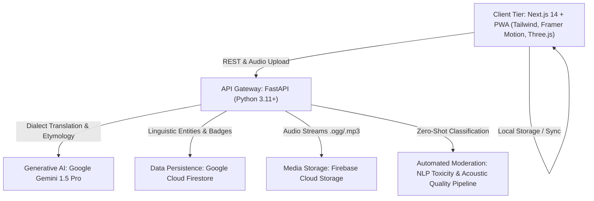

# ನಮ್ಮ ಕನ್ನಡ — Regional Language Explorer (Enhanced Edition)
### KANNADA TECHNOLOGY CHALLENGE – Problem Statement 04
**Domain:** Culture & Heritage / Artificial Intelligence / Linguistic Preservation

---

## 🌟 Executive Summary
**Namma Kannada** is an interactive, crowdsourced digital repository and living archive designed to digitally preserve, document, and gamify the rich linguistic diversity of Karnataka. While Standard Kannada (ಶಾಲಾ ಕನ್ನಡ) serves as the formal medium of administration and education, regional dialects—such as **Dharwad (North Karnataka), Kundapura / Karavali (Coastal), Havyaka (Malnad), Hyderabad Karnataka (Kalyana Karnataka), Kodava (Coorg), and Soliga (Tribal)**—carry centuries of oral literature, cultural ethos, and intangible heritage.

The platform integrates **Next.js 14, FastAPI, Google Gemini 1.5 Pro, WebXR/Three.js, Leaflet geospatial mapping, and an offline-first Progressive Web App (PWA)** to make Karnataka's dialects accessible, researchable, and engaging.

---

## 🏛️ System Architecture



---

## 🚀 Core Modules & Features

### 1. 🗺️ Interactive Dialect Map & Explorer Workflow (Data Consumption)
- **Geospatial Mapping:** Centered on Karnataka with dynamic `react-leaflet` vector overlays.
- **Dialect Zones:** North Karnataka, Coastal/Karavali, Old Mysuru, Malnad/Havyaka, Hyderabad Karnataka, Kodagu, and Soliga Tribal.
- **Regional Dashboard:** Displays authentic local expressions, phonetic guides, and standard Kannada equivalents.
- **Audio Playback:** High-fidelity playback of authentic spoken snippets.

### 2. 🤖 Generative AI Dialect Translator (Powered by Google Gemini)
- Bidirectional translation from **Standard Kannada or English** into authentic regional vernaculars.
- Synthesizes grammatical shifts (e.g., `-ತಿ`, `-ಆತಿ` verbal conjugations in North Karnataka, or Tulu-infused syntax in Kundapura).
- Contextual enrichment detailing cultural origins and situational usage guidelines.

### 3. 🎙️ Real-Time Speech-to-Text (STT) Dialect Transcriber
- In-browser microphone acoustic capture.
- Real-time normalization engine mapping regional spoken variations into standardized Kannada script.

### 4. ✍️ Contributor Workflow & Offline-First Field Collection (PWA)
- Progressive Web App architecture equipped with IndexedDB queueing.
- Researchers and volunteers in remote forest or rural areas can document dialect expressions without internet.
- Captures audio pronunciations (3–5 seconds) via browser `MediaRecorder` API.
- Geolocation metadata tagging (`lat`/`lng`).
- Automatic background synchronization when connectivity is restored.

### 5. 🛡️ Hybrid AI Moderation & Admin Review Pipeline
- Automated toxicity check and zero-shot content classification.
- Acoustic signal-to-noise check for audio quality.
- Auto-enrichment: Calls Gemini API to provide cultural context if the contributor left it empty.
- Human-in-the-Loop (HITL) Linguist portal (`/admin`) for verified scholars to publish or reject submissions.

### 6. 🏆 Gamified Linguistic Challenges & Badges
- Interactive quizzes testing dialect comprehension, audio recognition, and vocabulary.
- Digital heritage badges: *Mysuru Scholar*, *Karavali Expert*, *Malnad Maven*, *North KA Navigator*, *Kodagu Keeper*, *Polyglot*.
- Public leaderboard ranking contributors and quiz masters.

### 7. 🏛️ WebXR 3D Cultural Artifact Museum
- Three.js / WebXR module rendering tangible material culture linked to dialects:
  - **Mysore Peta** (Royal turban)
  - **Yakshagana Kireeta** (Coastal dance-drama crown)
  - **Ilkal Saree** (North Karnataka handloom)
  - **Kodava Peechekathi** (Ceremonial martial knife)
  - **Bisi Bele Bath** (Traditional culinary staple)

### 8. 📜 Visual Etymology Knowledge Graph
- Interactive SVG node-based network visualizer tracing words across historical eras:
  - Proto-Dravidian, Halegannada (Old Kannada), Sanskrit cognates, Persian loanwords, and modern vernacular branches.

### 9. 📡 Developer REST API & API Key Provisioning
- Clean endpoints opening structured dialect data to academic institutions and developers:
  - `GET /api/v1/phrases`
  - `GET /api/v1/dialects/{region_id}`
  - `POST /api/v1/translate/dialect`
  - `GET /api/v1/etymology/{word}`
  - `GET /api/v1/geo/regions`

---

## 💻 Tech Stack Specification

| Tier | Technologies |
|---|---|
| **Frontend** | Next.js 14 (App Router), TypeScript, Tailwind CSS, Framer Motion, Lucide Icons, Zustand |
| **Geospatial & 3D** | Leaflet, React-Leaflet, Three.js, `@react-three/fiber`, `@react-three/drei` |
| **Backend API** | Python 3.11+, FastAPI, Uvicorn, Pydantic v2, Python-Jose |
| **AI / NLP** | Google Gemini 1.5 Pro (`google-generativeai` / `google-genai`), PyTorch, Scikit-learn |
| **Data & Storage** | Google Cloud Firestore, Firebase Cloud Storage, Firebase Authentication |
| **PWA & Offline** | Web App Manifest, Service Workers, IndexedDB, MediaRecorder API |

---

## 🛠️ Getting Started

### Prerequisites
- Node.js v18+ & npm
- Python 3.11+
- Google Gemini API key (optional for local fallback mode)

### 1. Backend Setup
```bash
cd backend
python -m venv venv
# Windows:
.\venv\Scripts\activate
# Linux/macOS:
source venv/bin/activate

pip install -r requirements.txt
cp .env.example .env
# Edit .env with your GEMINI_API_KEY if available

uvicorn main:app --reload --port 8000
```
- API Documentation: [http://localhost:8000/docs](http://localhost:8000/docs)
- Health check: [http://localhost:8000/health](http://localhost:8000/health)

### 2. Frontend Setup
```bash
cd frontend
npm install
npm run dev
```
- Web Application: [http://localhost:3000](http://localhost:3000)
- Production Build: `npm run build && npm start`

---

## 👥 Contributors & Heritage Mission
Designed and developed for the **Kannada Technology Challenge — Problem Statement 04**.
Dedicated to the vibrant communities, tribal elders, folklore artists, and speakers across every corner of Karnataka.
*ನಿಮ್ಮ ಭಾಷೆ, ನಿಮ್ಮ ಹೆಮ್ಮೆ — Your Language, Your Pride.*
